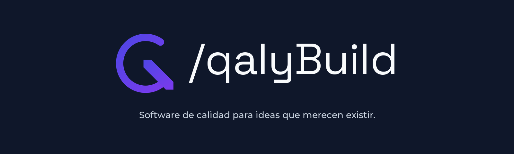

# Qaly

**/qalyBuild — construir a la manera de Qaly.**

En Qaly creamos proyectos para conectar personas, organizar el trabajo y hacer que las buenas ideas avancen.

[Explorar openQomu](https://github.com/qalyBuild/openQomu) · [Documentación](https://github.com/qalyBuild/openQomu/blob/main/README.es.md) · [Contribuir](https://github.com/qalyBuild/openQomu/blob/main/CONTRIBUTING.md)

---

## Lo que estamos construyendo

### [openQomu](https://github.com/qalyBuild/openQomu)

Un espacio de trabajo colaborativo y autoalojable que reúne conversaciones, tableros Kanban, documentos y archivos en un mismo lugar.

💬 **Conversaciones** · 📋 **Tableros** · 📝 **Documentos** · 🗂️ **Archivos**

Puedes probarlo localmente o desplegarlo en tu propia infraestructura. El proyecto es de código abierto y está disponible bajo la licencia [AGPL-3.0](https://github.com/qalyBuild/openQomu/blob/main/LICENSE).

[Conoce el proyecto →](https://github.com/qalyBuild/openQomu)

---

Hecho en equipo, una idea a la vez. ✨

